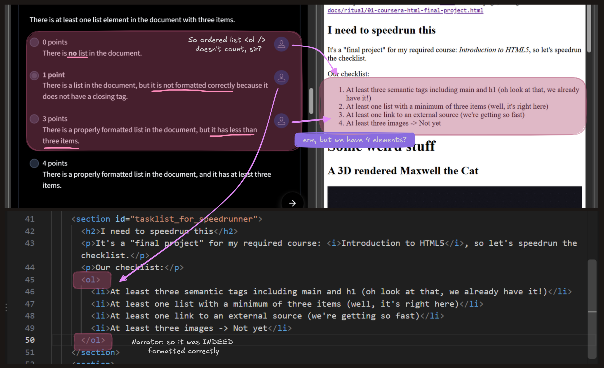

# A dumping place and nothing else
This is a repo if for some reason, my university required me to learn a web programming course and/or making a small web project (¯\\(ツ)/¯), I will put into here.

Originally, I put it inside my other project: [unnamed-spinning-cube](https://github.com/lilunderDuck/unnamed-spinning-cube), but I decided to move it into another repo to seperate my project.

Structure of this one hell of counter measurements include:
- `docs`: the nightmare fuel, every projects live here.
- `docs/assets`: global assets to be used across all project
- `scripts`: scripts for auto-generating code, if *too much duplicate code*, because I love fun :)
- `held-readme-for-hostage`: some images and stuff for `README.md`

I need something as a cover image of readme, so... here a review of someone rate my work unfairly, I love cousera peer rating so much.
