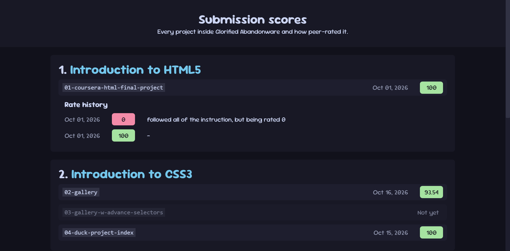

# A dumping place and nothing else
This is a repo if for some reason, my university required me to learn a web programming course and/or making a small web project (¯\\(ツ)/¯), I will put into here.

Originally, I put it inside my other project: [`unnamed-spinning-cube`](https://github.com/lilunderDuck/unnamed-spinning-cube), but I decided to move it into another repo to seperate my project.

# Finding the code responsible for multiple violations 
This fever-dreams-kind-of repo includes the following folders:
- `docs`: the nightmare fuel, every projects live here.
- `docs/assets`: global assets to be used across all project inside `docs`.
- `scripts`: core (hacked-together) library to generate HTML, CSS and pure Javascript code.
- `ritual`: scripts for auto-generating code, if *too much duplicate code*, because I love fun.
- `held-readme-for-hostage`: some images and stuff for `README.md`.

Additionally, the folder name in `ritual` matches with the one in `docs`, so you can easily find which one in `ritual` generates the output code in `docs`.

Also, the project is cleanly number-labeled, so you can clearly found out which project I did first... or you can see a nicer version [here](https://lilunderduck.github.io/glorified-abandonware), which display everything in a list with color and stuff

# Just explore the repo I think?
I need something as a cover image of readme, so... here a review of someone rate my work unfairly, I love coursera peer rating so much.
